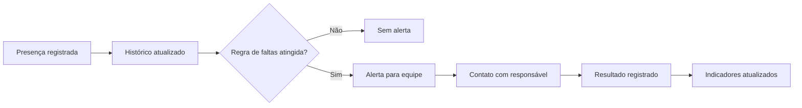
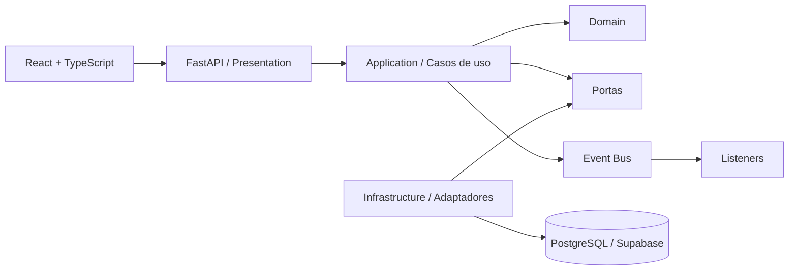

<div align="center">

# Livre Acesso

<p><strong>Gestão social com informação organizada, ação antecipada e cuidado com pessoas</strong></p>

[](#estado-do-projeto)
[](https://www.python.org/)
[](https://fastapi.tiangolo.com/)
[](docs/architecture.md)
[](#segurança-privacidade-e-lgpd)

**Projeto de extensão da equipe HumaniTec para o Instituto Livre Acesso, em Ceilândia, Distrito Federal.**

[Visão](#visão-do-produto) · [Começar agora](#comece-em-5-minutos) · [Como usar](#como-usar-a-versão-atual) · [Arquitetura](#arquitetura) · [Roadmap](#roadmap) · [Equipe](#equipe-humanitec)

</div>

---

## Em uma frase

O **Livre Acesso** substitui fichas de papel, controles de memória e mensagens dispersas por uma plataforma capaz de organizar alunos, responsáveis, turmas, presença, vagas e comunicação — permitindo que a instituição perceba um problema **antes** de uma criança abandonar uma atividade ou uma vaga permanecer ociosa.

> [!NOTE]
> Este repositório está na fase de fundação técnica. A API inicial, a verificação JWT e a primeira migration Supabase já existem, mas integração persistente, chamada, lista de espera, comunicação e interface React ainda fazem parte do roadmap. Consulte sempre a [matriz de estado](#estado-do-projeto) antes de demonstrar uma funcionalidade.

## Sumário

- [Visão do produto](#visão-do-produto)
- [Problema e impacto esperado](#problema-e-impacto-esperado)
- [Públicos e capacidades](#públicos-e-capacidades)
- [Estado do projeto](#estado-do-projeto)
- [Comece em 5 minutos](#comece-em-5-minutos)
- [Como usar a versão atual](#como-usar-a-versão-atual)
- [Como será o uso pela instituição](#como-será-o-uso-pela-instituição)
- [API e contratos](#api-e-contratos)
- [Arquitetura](#arquitetura)
- [Estrutura do repositório](#estrutura-do-repositório)
- [Domínio, eventos e regras](#domínio-eventos-e-regras)
- [Configuração local](#configuração-local)
- [Qualidade e testes](#qualidade-e-testes)
- [Segurança, privacidade e LGPD](#segurança-privacidade-e-lgpd)
- [Roadmap](#roadmap)
- [Como contribuir](#como-contribuir)
- [Solução de problemas](#solução-de-problemas)
- [Equipe HumaniTec](#equipe-humanitec)
- [Documentação](#documentação)

## Visão do produto

Hoje, tarefas essenciais podem depender de uma pasta física, uma lista de chamada, uma planilha isolada, um grupo de WhatsApp ou da memória de alguém. O Livre Acesso organiza esse trabalho em um fluxo simples e rastreável.

A plataforma foi idealizada para:

1. manter um cadastro único e confiável de participantes e responsáveis;
2. facilitar consultas e atualizações sem percorrer fichas físicas;
3. registrar presença em poucos toques;
4. identificar faltas consecutivas e inatividade;
5. administrar capacidade, vagas e lista de espera com transparência;
6. enviar comunicados por turma e acompanhar o alcance;
7. produzir indicadores sem conferência manual;
8. proteger dados pessoais com acesso controlado e auditoria.

### Princípios do produto

- **A rotina vem primeiro:** a ferramenta acompanha o trabalho real da secretaria e dos instrutores.
- **Uma fonte de verdade:** o mesmo cadastro atende turmas, chamada, comunicação e relatórios.
- **Alertar, não apenas armazenar:** dados devem gerar ações úteis.
- **Mobile de verdade:** operações de campo precisam funcionar bem no celular.
- **Privacidade por padrão:** coletar somente o necessário e revelar somente a quem precisa.
- **Evolução incremental:** cada etapa deve entregar um fluxo utilizável e testável.

## Problema e impacto esperado

| Situação atual | Com o Livre Acesso |
| --- | --- |
| Fichas duplicadas ou desatualizadas | CPF normalizado e verificado antes de concluir o cadastro. |
| Contato encontrado manualmente em papel | Pesquisa única por nome, CPF ou turma. |
| Chamada sem histórico consolidado | Presença registrada por turma, data e participante. |
| Faltas percebidas somente após desistência | Alerta após a regra de ausências definida pela instituição. |
| Vaga ociosa enquanto existe lista de espera | Inatividade sinalizada e processo de vaga rastreável. |
| Aviso perdido em grupo de mensagens | Comunicado vinculado à turma, destinatários e estado de entrega/leitura. |
| Relatório montado manualmente | Indicadores derivados dos próprios registros operacionais. |

O impacto social esperado é uma gestão mais organizada, maior capacidade de acompanhamento dos participantes e melhor aproveitamento das atividades educacionais, culturais e esportivas.

## Públicos e capacidades

### Perfis previstos

| Perfil | Uso principal |
| --- | --- |
| Coordenação | Indicadores, gestão completa, relatórios, vagas e auditoria. |
| Recepção/secretaria | Cadastro, consulta, atualização e matrículas. |
| Instrutor | Turmas sob sua responsabilidade e registro de presença. |
| Consulta | Acesso restrito a informações e relatórios autorizados. |

Os nomes e limites definitivos dos perfis serão validados com a instituição antes do piloto.

### Módulos do produto

| Módulo | Responsabilidade |
| --- | --- |
| Identidade e acesso | Login, sessão, papéis e autorização. |
| Painel | Alunos ativos, turmas, faixa etária, lista de espera e alertas. |
| Alunos e responsáveis | Cadastro, pesquisa, atualização e validação de CPF/contato. |
| Turmas e matrículas | Modalidades, horários, capacidade, vínculo e situação da matrícula. |
| Chamada | Presença, falta, justificativa e histórico. |
| Vagas e lista de espera | Elegibilidade, ordem, seleção e trilha auditável. |
| Comunicados | Mensagem por turma, destinatários, entrega e leitura. |
| Relatórios | Frequência, ausências, ocupação e alcance dos comunicados. |
| Auditoria | Quem realizou ações relevantes, quando e em qual registro. |

## Estado do projeto

Legenda: **Disponível** = implementado no repositório; **Parcial** = fundação existente, fluxo incompleto; **Planejado** = ainda não implementado.

| Área | Estado | Evidência atual |
| --- | --- | --- |
| Fundação FastAPI | **Disponível** | Fábrica da aplicação, configuração e endpoint `/health`. |
| Cadastro de aluno | **Disponível** | `POST /api/v1/students`. |
| Gestão cadastral | **Disponível** | Detalhe, edição versionada, ativação e desativação lógica. |
| Responsáveis múltiplos | **Disponível** | Seis rotas, principal único, matriz 35/35 e smoke JWT aprovados em produção. |
| Listagem e filtros | **Disponível** | `GET /api/v1/students` por status cadastral. |
| CPF e telefone | **Disponível** | Normalização, validação, unicidade e mascaramento. |
| DTO, mapper e caso de uso | **Disponível** | Camadas separadas no módulo `students`. |
| Erros e rastreabilidade | **Disponível** | Problem Details, erros por campo e `X-Request-ID`. |
| Eventos e listener | **Disponível** | `StudentRegistered` e auditoria sem PII. |
| Testes automatizados | **Disponível** | Unidade, integração e guardas arquiteturais executadas localmente. |
| Schema Supabase | **Disponível** | Sete migrations aplicadas e verificadas no projeto de São Paulo. |
| Persistência da API | **Disponível** | Gateway HTTP e adaptador de alunos usam RPCs com o JWT da requisição. |
| Autenticação | **Disponível** | Bearer JWT/JWKS homologado com conta real do Supabase Auth. |
| Deploy do backend | **Disponível** | Produção em `gru1`, readiness e smoke autenticado aprovados. |
| Autorização operacional | **Disponível** | Matriz remota 31/31 e `/me` autenticado como coordenação ativa aprovados em produção. |
| Turmas e matrículas | **Planejado** | Modelo definido arquiteturalmente. |
| Chamada e alertas | **Planejado** | Regra depende de validação com a instituição. |
| Lista de espera | **Planejado** | Critérios operacionais e jurídicos pendentes. |
| Comunicados | **Planejado** | Provedor e significado de leitura pendentes. |
| Relatórios | **Planejado** | Entrará após dados operacionais confiáveis. |
| Front-end React | **Planejado** | Experiência e telas já concebidas; implementação ainda não iniciada. |

> [!IMPORTANT]
> Produção persiste no Supabase por RPCs protegidas com o JWT da requisição. O repositório em memória existe somente para `development` e `test`; configuração incompleta em produção falha fechada e não deve receber dados reais.

## Comece em 5 minutos

### 1. Clone o repositório

```powershell
git clone https://github.com/ObarbosaDev/LivreAcesso.git
Set-Location LivreAcesso
```

### 2. Crie e ative um ambiente Python isolado

```powershell
python -m venv .venv
.\.venv\Scripts\Activate.ps1
```

Se `python` não existir ou apontar para uma versão anterior, instale Python 3.11 ou superior e confirme com `python --version`.

### 3. Instale a aplicação e as ferramentas de desenvolvimento

```powershell
python -m pip install --upgrade pip
python -m pip install -e ".[dev]"
```

As versões estão fixadas em [`pyproject.toml`](pyproject.toml), garantindo uma base reproduzível.

### 4. Inicie a API

```powershell
python main.py
```

### 5. Verifique

Abra:

- API: <http://127.0.0.1:8000>
- Swagger/OpenAPI: <http://127.0.0.1:8000/docs>
- Health check: <http://127.0.0.1:8000/health/live>
- Readiness: <http://127.0.0.1:8000/health/ready>

Ou teste pelo PowerShell:

```powershell
Invoke-RestMethod -Uri "http://127.0.0.1:8000/health/live"
```

Resultado esperado:

```json
{
  "status": "alive",
  "service": "Livre Acesso API",
  "version": "0.1.0"
}
```

## Como usar a versão atual

A versão atual é uma **API**. O modo mais simples de explorá-la é pelo Swagger em `/docs`; também é possível usar os exemplos abaixo em outro terminal PowerShell enquanto `python main.py` estiver em execução.

> [!CAUTION]
> Use somente dados fictícios. Os exemplos abaixo existem para desenvolvimento e demonstração técnica.

### Preparar a autenticação

As rotas de alunos exigem um JWT de uma conta não anônima do Supabase Auth. Obtenha um token efêmero de uma conta de teste e leia-o sem gravá-lo em arquivo ou no histórico do terminal:

```powershell
$secureToken = Read-Host "Token de teste" -AsSecureString
$accessToken = [System.Net.NetworkCredential]::new("", $secureToken).Password
$headers = @{ Authorization = "Bearer $accessToken" }
```

Sem `SUPABASE_URL`, as rotas protegidas retornam `503` por segurança. Token ausente ou inválido retorna `401`; `/health` e `/docs` continuam públicos.

### Cadastrar um aluno

O cadastro cria a pessoa e seu responsável principal. Modalidade e turma não entram neste payload porque pertencem ao futuro fluxo de matrícula.

```powershell
$student = @{
    full_name = "Sophia Almeida Ramos"
    cpf = "529.982.247-25"
    birth_date = "2015-05-10"
    guardian = @{
        full_name = "Camila Ramos"
        phone = "(61) 99999-1234"
        email = "camila@example.com"
    }
} | ConvertTo-Json -Depth 4

Invoke-RestMethod `
    -Method Post `
    -Uri "http://127.0.0.1:8000/api/v1/students" `
    -Headers $headers `
    -ContentType "application/json" `
    -Body $student
```

A resposta não devolve CPF ou telefone completos:

```json
{
  "id": "gerado-pela-api",
  "full_name": "Sophia Almeida Ramos",
  "cpf_masked": "***.***.***-25",
  "birth_date": "2015-05-10",
  "age": 11,
  "status": "ativo",
  "guardian_name": "Camila Ramos",
  "guardian_phone_masked": "(61) *****-1234",
  "created_at": "2026-10-21T18:00:00Z"
}
```

Os valores de `id`, `age` e `created_at` variam conforme a execução e a data atual.

### Listar todos os alunos

```powershell
Invoke-RestMethod `
    -Uri "http://127.0.0.1:8000/api/v1/students" `
    -Headers $headers
```

### Filtrar por status cadastral

Status aceitos: `ativo` e `inativo`. Lista de espera será um estado de matrícula, não do aluno.

```powershell
Invoke-RestMethod `
    -Uri "http://127.0.0.1:8000/api/v1/students?status=ativo" `
    -Headers $headers
```

### Conferir a prevenção de CPF duplicado

Execute o cadastro duas vezes. A segunda tentativa retorna HTTP `409`:

```json
{
  "type": "urn:livre-acesso:problem:duplicate-cpf",
  "title": "CPF já cadastrado",
  "status": 409,
  "detail": "Confira o cadastro existente antes de continuar.",
  "code": "duplicate_cpf",
  "request_id": "uuid-da-requisicao",
  "errors": [
    {
      "field": "cpf",
      "code": "duplicate_cpf",
      "message": "Este CPF já pertence a um cadastro."
    }
  ]
}
```

### Encerrar a API

No terminal em que a aplicação está rodando, pressione `Ctrl+C`. Somente o modo local sem Supabase usa persistência em memória e descarta os registros dessa execução.

## Como será o uso pela instituição

Esta seção descreve o **fluxo-alvo do front-end**, não funcionalidades já entregues.

### Coordenação/secretaria

1. entrar com uma conta autorizada;
2. visualizar no painel alunos ativos, turmas, alertas e lista de espera;
3. pesquisar antes de iniciar um cadastro;
4. cadastrar participante e responsável em um fluxo curto;
5. vincular o participante a uma turma ou lista de espera;
6. corrigir contatos e dados cadastrais com auditoria;
7. acompanhar ausências e agir sobre alertas;
8. enviar comunicados às famílias da turma;
9. consultar relatórios para reunião e planejamento.

### Instrutor

1. acessar somente as turmas autorizadas;
2. selecionar turma e data;
3. marcar presença, falta ou justificativa;
4. revisar antes de concluir a chamada;
5. acompanhar alertas permitidos, sem acesso desnecessário a dados sensíveis.

### Fluxo de ação esperado



As regras exatas — quantidade de faltas, prazo de inatividade e liberação de vaga — precisam de aprovação formal do Instituto Livre Acesso.

## API e contratos

### Endpoints disponíveis

| Método | Rota | Autenticação | Descrição | Sucesso |
| --- | --- | --- | --- | --- |
| `GET` | `/` | Pública | Metadados e link da documentação. | `200` |
| `GET` | `/health` | Pública | Compatibilidade com o liveness anterior. | `200` |
| `GET` | `/health/live` | Pública | Confirma apenas que o processo responde. | `200` |
| `GET` | `/health/ready` | Pública | Confirma que a persistência está disponível. | `200/503` |
| `GET` | `/docs` | Pública | Interface interativa OpenAPI. | `200` |
| `GET` | `/openapi.json` | Pública | Contrato OpenAPI em JSON. | `200` |
| `GET` | `/api/v1/me` | Bearer JWT | Consulta próprio perfil e capacidades. | `200` |
| `PUT` | `/api/v1/me` | Bearer JWT | Atualiza o próprio nome com versão. | `200` |
| `GET` | `/api/v1/profiles` | Coordenação | Pesquisa perfis operacionais. | `200` |
| `POST` | `/api/v1/profiles/{id}/role` | Coordenação | Atribui papel com motivo. | `200` |
| `POST` | `/api/v1/profiles/{id}/activate` | Coordenação | Ativa perfil com papel definido. | `200` |
| `POST` | `/api/v1/profiles/{id}/deactivate` | Coordenação | Bloqueia perfil sem excluir conta. | `200` |
| `GET` | `/api/v1/students` | Bearer JWT | Pesquisa paginada com filtros. | `200` |
| `POST` | `/api/v1/students` | Bearer JWT | Cadastra aluno e responsável. | `201` |
| `GET` | `/api/v1/students/{id}` | Bearer JWT | Consulta detalhe sensível e auditado. | `200` |
| `PUT` | `/api/v1/students/{id}` | Bearer JWT | Atualiza dados usando `updated_at`. | `200` |
| `POST` | `/api/v1/students/{id}/deactivate` | Bearer JWT | Desativa com motivo, sem excluir histórico. | `200` |
| `POST` | `/api/v1/students/{id}/activate` | Bearer JWT | Reativa o mesmo cadastro. | `200` |

### Convenções

- API versionada sob `/api/v1`;
- JSON em `snake_case` nesta fase;
- datas civis em `YYYY-MM-DD`;
- instantes em UTC e ISO 8601;
- UUID como identificador técnico;
- códigos de erro estáveis para o front-end;
- entidades do domínio nunca são serializadas diretamente;
- listagens mascaram dados sensíveis.

### Formato de erro

Erros de negócio e validação usam `application/problem+json`, um código estável, um `request_id` rastreável e mensagens por campo. Valores recebidos e dados pessoais não são repetidos na resposta.

```json
{
  "type": "urn:livre-acesso:problem:duplicate-cpf",
  "title": "CPF já cadastrado",
  "status": 409,
  "detail": "Confira o cadastro existente antes de continuar.",
  "code": "duplicate_cpf",
  "request_id": "uuid-da-requisicao",
  "errors": [
    {
      "field": "cpf",
      "code": "duplicate_cpf",
      "message": "Este CPF já pertence a um cadastro."
    }
  ]
}
```

O mesmo `request_id` é enviado no cabeçalho `X-Request-ID`, permitindo suporte técnico sem pedir que a pessoa compartilhe CPF, telefone ou corpo da requisição.

## Arquitetura

A solução adota um **monólito modular** com princípios de DDD, Clean Architecture e arquitetura hexagonal. É uma escolha deliberada: oferece separação de responsabilidades e evolução segura sem impor a operação distribuída de microserviços a uma demanda que não precisa disso.



### Regra de dependência

```text
presentation ─┐
              ├──> application ───> domain
infrastructure┘           │
                          └──> portas/contratos
```

O domínio não conhece FastAPI, PostgreSQL, Supabase, React nem detalhes de transporte.

### Por que não microserviços

- o volume previsto não exige distribuição;
- a equipe precisa de desenvolvimento e depuração simples;
- transações de matrícula, presença e vagas se beneficiam de consistência local;
- observabilidade e infraestrutura distribuídas aumentariam o risco do projeto;
- limites modulares preservam a opção de extração futura, se métricas reais justificarem.

Detalhes, decisões pendentes, persistência, segurança e evolução: [`docs/architecture.md`](docs/architecture.md).

## Estrutura do repositório

```text
LivreAcesso/
├── backend/
│   └── app/
│       ├── core/                       # Configuração e composição de dependências
│       ├── shared/
│       │   ├── application/            # Barramento e contratos compartilhados
│       │   ├── domain/                 # Primitivas de domínio
│       │   └── presentation/           # Problem Details e request ID
│       └── modules/
│           └── students/
│               ├── domain/             # Entidades, VOs, eventos, erros e portas
│               ├── application/        # DTOs, mappers, casos de uso e listeners
│               ├── infrastructure/     # Adaptadores de persistência
│               └── presentation/       # Endpoints HTTP
├── docs/
│   ├── architecture.md                 # Arquitetura e decisões técnicas
│   ├── backend-blueprint.md            # Fluxos, segurança e integração Supabase
│   └── domain-glossary.md              # Linguagem comum do negócio
├── supabase/
│   ├── migrations/                     # Schema, RLS, RPCs, auditoria e outbox
│   └── README.md                       # Operação segura do Supabase
├── tests/
│   ├── architecture/                   # Guardas de migration e segurança
│   ├── integration/                    # Integração HTTP entre camadas
│   └── unit/                           # Regras isoladas e casos de uso
├── .gitignore                          # Segredos, ambientes e artefatos locais
├── CONTRIBUTING.md                     # Fluxo de contribuição
├── SECURITY.md                         # Política de segurança
├── main.py                             # Entrada local simplificada
├── pyproject.toml                      # Dependências fixadas e qualidade
└── README.md                           # Porta de entrada do projeto
```

O front-end será criado em `frontend/` somente quando sua implementação começar. A estrutura planejada está no documento de arquitetura; evitar pastas vazias mantém o repositório honesto.

## Domínio, eventos e regras

### Modelo inicial

| Conceito | Tipo | Responsabilidade |
| --- | --- | --- |
| `Student` | Agregado raiz | Protege identidade, situação cadastral e vínculo com responsável. |
| `Guardian` | Entidade interna | Representa responsável ou contato responsável. |
| `CPF` | Value Object | Normaliza, valida e mascara o documento. |
| `Phone` | Value Object | Normaliza e mascara o contato. |
| `StudentRepository` | Porta | Define o que a aplicação exige da persistência. |
| `RegisterStudent` | Caso de uso | Verifica duplicidade, persiste e publica eventos. |
| `StudentRegistered` | Evento | Registra o fato de um aluno ter sido cadastrado. |
| `StudentRegisteredAuditListener` | Listener | Produz auditoria técnica sem PII. |

### Eventos planejados

- `StudentRegistered`;
- `StudentContactMissing`;
- `AttendanceRecorded`;
- `ConsecutiveAbsencesDetected`;
- `StudentInactivityDetected`;
- `VacancyReleased`;
- `WaitingListSelectionCompleted`;
- `CommunicationSent`;
- `CommunicationRead`.

Eventos externos confiáveis deverão usar **Transactional Outbox**. Publicar para um provedor depois do commit sem outbox deixaria uma janela de perda que não é aceitável para alertas e comunicações.

A linguagem oficial do domínio está em [`docs/domain-glossary.md`](docs/domain-glossary.md).

## Configuração local

A aplicação lê configuração diretamente das variáveis do processo. **Nenhum arquivo `.env`, inclusive exemplo, pode ser adicionado ao Git.** O `.gitignore` protege variações desse nome em qualquer pasta.

| Variável | Padrão | Finalidade |
| --- | --- | --- |
| `APP_NAME` | `Livre Acesso API` | Nome exposto nos metadados. |
| `APP_VERSION` | `0.1.0` | Versão informativa da API. |
| `APP_ENV` | `development` | Identifica o ambiente em execução. |
| `APP_HOST` | `127.0.0.1` | Interface de rede local. |
| `APP_PORT` | `8000` | Porta HTTP. |
| `APP_DEBUG` | `false` | Logs detalhados e reload local. |
| `APP_CORS_ORIGINS` | `http://localhost:5173` | Origens do front separadas por vírgula. |
| `SUPABASE_URL` | sem padrão | URL HTTPS usada para obter as chaves públicas JWKS. |
| `SUPABASE_PUBLISHABLE_KEY` | sem padrão | Identifica o projeto nas RPCs; a autorização continua dependendo do JWT. |

Exemplo somente para a sessão atual do PowerShell:

```powershell
$env:APP_DEBUG = "true"
$env:APP_PORT = "8080"
$env:APP_CORS_ORIGINS = "http://localhost:5173,http://localhost:4173"
$env:SUPABASE_URL = "https://<project-ref>.supabase.co"
python main.py
```

Para remover as variáveis da sessão:

```powershell
Remove-Item Env:APP_DEBUG, Env:APP_PORT, Env:APP_CORS_ORIGINS, Env:SUPABASE_URL
```

Em hospedagem, use exclusivamente o painel de variáveis/segredos da plataforma.

### Homologação com JWT real

Para testar Supabase Auth, validação JWKS, FastAPI e a RPC remota sem iniciar servidor:

```powershell
livre-acesso-verify-supabase
```

O comando pede URL, chave publicável, conta sintética e senha. A chave e a senha ficam ocultas, o JWT permanece somente em memória e a operação consulta apenas a listagem paginada. Nenhuma credencial é gravada ou exibida.

## Qualidade e testes

### Comandos

```powershell
pytest
ruff check .
ruff format --check .
mypy backend
pytest --cov=backend --cov-report=term-missing
```

### Estratégia

| Camada | Verifica | Exemplos |
| --- | --- | --- |
| Unidade | Regra pura | CPF, telefone, idade, transições e faltas. |
| Aplicação | Orquestração | Duplicidade, repositório, publicação de evento. |
| Integração | Contrato e adaptadores | HTTP, banco, migrations e transações. |
| E2E | Jornada crítica | Cadastro → matrícula → chamada → alerta. |

A cobertura mínima configurada é 80%, mas percentual não substitui cenários relevantes. Regras críticas precisam de casos explícitos para sucesso, limite e falha.

### Critério de pronto

Uma entrega não está pronta apenas porque “funciona na máquina de alguém”. Ela precisa:

- atender ao comportamento acordado;
- manter os limites arquiteturais;
- incluir ou atualizar testes pertinentes;
- não expor PII, segredo ou credencial;
- atualizar documentação e contrato quando necessário;
- passar por revisão de código;
- possuir evidência de validação executável.

## Segurança, privacidade e LGPD

O sistema lida com dados de crianças, adolescentes, adultos e responsáveis. Segurança é requisito funcional, não acabamento.

### Regras inegociáveis

- nunca usar dados reais em testes, exemplos, prints ou seeds;
- nunca versionar `.env`, credenciais, tokens ou chaves;
- nunca registrar CPF, telefone, e-mail ou endereço completos em logs;
- negar acesso por padrão e autorizar no back-end;
- mascarar dados em listas e relatórios;
- usar HTTPS em qualquer ambiente remoto;
- registrar acesso e alteração de dados sensíveis;
- definir retenção, correção e descarte com a instituição;
- testar backup e restauração antes do piloto;
- revisar integrações externas sob finalidade, consentimento e contrato.

Autenticação e proteção das rotas já estão implementadas, assim como o adaptador Supabase. Entretanto, **a API ainda não pode receber dados reais nem ficar exposta publicamente** até a migration, os papéis, RLS e as RPCs serem exercitados no projeto remoto com cada perfil operacional.

Para relatar uma vulnerabilidade, siga [`SECURITY.md`](SECURITY.md) e não abra uma issue pública com detalhes exploráveis ou dados pessoais.

## Roadmap

### Fase 0 — Fundação

- [x] monólito modular e regra de dependência;
- [x] configuração sem arquivos de ambiente;
- [x] domínio inicial de alunos separado de matrícula;
- [x] DTO, mapper, repositório, evento e listener;
- [x] Problem Details, erros por campo e request ID;
- [x] API inicial e testes automatizados;
- [x] blueprint e migration inicial do Supabase;
- [x] documentação técnica e operacional.

### Fase 1 — Cadastro confiável

- [x] schema inicial, constraints, auditoria e outbox;
- [x] autenticação Bearer e validação local de JWT por JWKS;
- [x] implementar o gateway e o adaptador Supabase na API;
- [x] aplicar e validar as sete migrations no projeto Supabase de São Paulo;
- [x] executar matriz SQL de 25 permissões com rollback;
- [x] validar FastAPI e PostgREST com JWT real;
- [x] publicar e validar Preview do FastAPI em `gru1`;
- [x] promover o backend para produção e repetir o smoke test;
- [x] CRUD seguro de alunos e responsável principal;
- [x] múltiplos responsáveis, parentesco e contato compartilhado entre irmãos;
- [x] principal único, desvinculação lógica e histórico privado;
- [x] matriz SQL de responsáveis 35/35 com rollback;
- [x] detalhe sensível auditado e CPF imutável no fluxo comum;
- [x] atualização com concorrência otimista;
- [x] ativação/desativação lógica com motivo protegido;
- [x] paginação, busca e auditoria transacional no schema;

### Fase 2 — Turmas e operação

- [x] modalidades, turmas, horários e capacidade;
- [x] matrículas e alterações de situação;
- [x] chamada responsiva;
- [x] histórico e justificativa;
- [x] alertas por faltas consecutivas.

### Fase 3 — Vagas e comunicação

- [x] inatividade revisável;
- [x] lista de espera;
- [x] processo de seleção rastreável;
- [x] comunicados por turma com outbox transacional;
- [x] processamento idempotente e rastreável da comunicação.

### Fase 4 — Experiência e inteligência

- [x] front-end React + TypeScript;
- [x] painel, relatórios individuais e exportação CSV/PDF;
- [x] acessibilidade básica e responsividade;
- [x] health checks e alertas operacionais;
- [x] testes automatizados de backend e frontend.

### Bloco 6 — Operação integrada

O bloco 6 está concluído no código e validado localmente. A jornada vertical cobre modalidade, turma, matrícula, chamada, faltas, alertas, lista de espera, comunicação, relatório individual e avaliação de desenvolvimento. A validação restante é operacional: executar o piloto com usuários reais e confirmar regras específicas da instituição.

### Fase 5 — Piloto

- [ ] validar regras com recepção, instrutores e coordenação;
- [ ] escolher uma turma piloto;
- [ ] operar em paralelo por período controlado;
- [ ] medir erros evitados, tempo de operação e aderência;
- [ ] corrigir e expandir gradualmente.

## Como contribuir

Leia [`CONTRIBUTING.md`](CONTRIBUTING.md) antes da primeira alteração.

Fluxo resumido:

```powershell
git checkout main
git pull
git checkout -b feat/nome-curto-da-entrega
# desenvolver e validar
git status
git add caminho/do/arquivo.py
git commit -m "feat: descreve a entrega"
git push -u origin feat/nome-curto-da-entrega
```

Nunca faça push direto para `main`. Prefira branches pequenas, commits objetivos e pull requests com contexto, evidência de teste e impacto em privacidade.

### Convenção de commits

| Prefixo | Uso |
| --- | --- |
| `feat` | Nova funcionalidade. |
| `fix` | Correção de comportamento. |
| `refactor` | Mudança interna sem alterar regra externa. |
| `test` | Criação ou ajuste de testes. |
| `docs` | Documentação. |
| `chore` | Ferramentas, configuração e manutenção. |

## Solução de problemas

<details>
<summary><strong><code>py</code> ou <code>python</code> não foi encontrado</strong></summary>

Instale Python 3.11 ou superior, habilite a opção de adicionar Python ao `PATH` e abra um novo terminal. Confirme com:

```powershell
python --version
```

</details>

<details>
<summary><strong>O PowerShell bloqueou <code>Activate.ps1</code></strong></summary>

Libere scripts somente para a sessão atual:

```powershell
Set-ExecutionPolicy -Scope Process -ExecutionPolicy Bypass
.\.venv\Scripts\Activate.ps1
```

</details>

<details>
<summary><strong>A porta 8000 está ocupada</strong></summary>

Escolha outra porta apenas na sessão local:

```powershell
$env:APP_PORT = "8080"
python main.py
```

</details>

<details>
<summary><strong>Os alunos desapareceram depois de reiniciar</strong></summary>

É o comportamento esperado quando `SUPABASE_URL` e `SUPABASE_PUBLISHABLE_KEY` não estão configuradas em `development` ou `test`. Fora desses ambientes, a aplicação recusa iniciar sem persistência Supabase para impedir perda silenciosa.

</details>

<details>
<summary><strong>Recebi <code>422</code> ao cadastrar</strong></summary>

Confira campos obrigatórios, data no formato `YYYY-MM-DD`, CPF válido e telefone com DDD. Modalidade e status não pertencem ao cadastro inicial. O Swagger em `/docs` mostra o contrato completo.

</details>

<details>
<summary><strong>Recebi <code>409 duplicate_cpf</code></strong></summary>

O CPF já foi registrado nesta execução. A API normaliza pontuação, então versões formatadas e sem formatação são consideradas o mesmo documento.

</details>

## Equipe HumaniTec

### Coordenação do projeto

- **Pedro da Costa Borges**

### Estudantes envolvidos

- Pedro Henrique de Caniza Gomes
- Rafael Belgrano Paixão Costa
- Giovana Oliveira de Queiroz
- Sara Adriele de Lima Andrade
- Júlio César Soares Cavalcante
- Matheus Pinheiro Barbosa
- Victor Gabriel Santos Silva
- Victor Augusto Ferreira Silva
- Rodrigo Ferreira dos Santos Pereira
- Kauã Thalles Silva de Jesus

### Professora responsável

- **Julianna Olinda Martins Pequeno**

| Informação acadêmica | Descrição |
| --- | --- |
| Instituição de ensino | Universidade Católica de Brasília |
| Unidade curricular | Extensão — Cooperação: Humanismo Solidário, Redes e Comunidades |
| Semestre letivo | 2026/2 |
| Projeto | HumaniTec |
| Instituição atendida | Instituto Livre Acesso — Ceilândia, Distrito Federal |

## Impacto social

O projeto está alinhado principalmente a:

- **ODS 3 — Saúde e Bem-Estar:** apoio à permanência em atividades culturais, esportivas e educacionais;
- **ODS 4 — Educação de Qualidade:** suporte a oportunidades inclusivas de aprendizagem e desenvolvimento.

## Documentação

| Documento | Conteúdo |
| --- | --- |
| [`docs/architecture.md`](docs/architecture.md) | Decisões, módulos, persistência, eventos, segurança e evolução. |
| [`docs/backend-blueprint.md`](docs/backend-blueprint.md) | Fluxos do backend, Supabase, sensibilidade, eventos e critérios de pronto. |
| [`docs/backend-task-plan.md`](docs/backend-task-plan.md) | Fonte atualizável dos 10 blocos de trabalho do backend. |
| [`docs/deployment.md`](docs/deployment.md) | Deploy do FastAPI na Vercel, variáveis, smoke e rollback. |
| [`docs/profile-management.md`](docs/profile-management.md) | Ciclo de acesso, papéis, capacidades e proteção administrativa. |
| [`docs/guardian-management.md`](docs/guardian-management.md) | Responsáveis múltiplos, parentesco, privacidade, versões e endpoints. |
| [`docs/LivreAcesso-Plano-Tarefas-Backend.pdf`](docs/LivreAcesso-Plano-Tarefas-Backend.pdf) | PDF de cinco páginas para distribuição à equipe. |
| [`docs/security-decisions.md`](docs/security-decisions.md) | Decisões, exceções conhecidas e controles compensatórios de segurança. |
| [`docs/domain-glossary.md`](docs/domain-glossary.md) | Linguagem comum, conceitos e regras pendentes do negócio. |
| [`supabase/README.md`](supabase/README.md) | Migrations, bootstrap, RLS e regras operacionais do Supabase. |
| [`CONTRIBUTING.md`](CONTRIBUTING.md) | Fluxo Git, padrões de código, testes e revisão. |
| [`SECURITY.md`](SECURITY.md) | Relato responsável de falhas e práticas obrigatórias. |
| [`pyproject.toml`](pyproject.toml) | Versões, dependências e configuração das ferramentas. |

## Licenciamento

Este é um projeto acadêmico de extensão. As condições de licenciamento e uso fora do contexto acadêmico ainda precisam ser definidas pela equipe e pela instituição atendida. A ausência de um arquivo de licença **não** concede permissão automática para copiar, redistribuir ou explorar o código.

---

<div align="center">

**HumaniTec × Instituto Livre Acesso**  
Tecnologia aplicada à organização, continuidade e impacto social.

</div>
