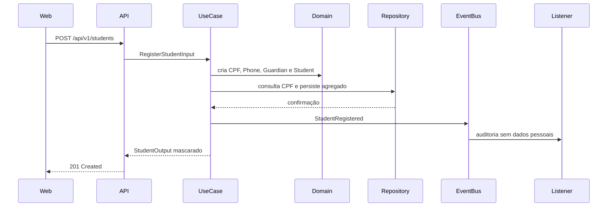

# Arquitetura de Software — Livre Acesso

## 1. Contexto e direcionadores

O Livre Acesso centraliza cadastros, responsáveis, turmas, matrículas, frequência, lista de espera, comunicados e relatórios. A solução precisa ser simples para a equipe administrativa, funcionar bem em desktop e celular e proteger dados pessoais de participantes — inclusive crianças e adolescentes.

Direcionadores principais:

1. equipe de desenvolvimento acadêmica e multidisciplinar;
2. aproximadamente centenas de participantes, não milhões de requisições;
3. regras de negócio mais importantes que escala horizontal prematura;
4. necessidade de evoluir por módulos sem reescrever a aplicação;
5. rastreabilidade de faltas, vagas, comunicados e alterações cadastrais;
6. segurança e privacidade desde a modelagem;
7. implantação de baixo custo em serviços gerenciados.

## 2. Decisão arquitetural

Será utilizado um **monólito modular**, com uma API FastAPI e módulos organizados por capacidade de negócio. Cada módulo segue quatro camadas:

- **domain:** entidades, agregados, objetos de valor, eventos, exceções e portas;
- **application:** casos de uso, DTOs, mappers e listeners de aplicação;
- **infrastructure:** banco, mensageria, relógio, provedores externos e demais adaptadores;
- **presentation:** HTTP, validação de protocolo e serialização.

### Por que não microserviços

Microserviços exigiriam implantação, observabilidade, autenticação entre serviços, consistência distribuída e operação de mensageria sem trazer benefício proporcional neste estágio. Os limites modulares permitem extrair um serviço futuramente se métricas reais justificarem essa decisão.

### Regra de dependência

```text
presentation ─┐
              ├──> application ───> domain
infrastructure┘           │
                          └──> portas definidas pelo domínio/aplicação
```

O domínio não importa FastAPI, SQLAlchemy, SDK do Supabase ou componentes do front-end.

## 3. Módulos de negócio

| Módulo | Agregados principais | Responsabilidades |
| --- | --- | --- |
| Identity & Access | User, Role, Session | Login, autorização, recuperação e bloqueio. |
| Students | Student, Guardian | Cadastro, CPF único, contatos e situação cadastral. |
| Classes | Class, Enrollment | Modalidades, horários, capacidade e matrícula. |
| Attendance | AttendanceSession | Chamada, justificativas e faltas consecutivas. |
| Waiting List | WaitingList, VacancyProcess | Ordem, elegibilidade, vagas e seleção auditável. |
| Communications | Message, Delivery | Comunicados, destinatários, entrega e leitura. |
| Reporting | Read models | Indicadores e consultas agregadas. |
| Audit | AuditEntry | Registro imutável de ações relevantes. |

No código inicial, apenas o módulo `students` foi materializado. Os demais entram como módulos próprios quando suas regras forem implementadas; não devem ser adicionados como arquivos vazios.

## 4. Organização do repositório

### Estado atual do back-end

```text
backend/app/
├── main.py
├── core/
│   ├── config.py
│   └── container.py
├── shared/
│   ├── application/
│   │   └── event_bus.py
│   └── domain/
│       └── events.py
└── modules/
    └── students/
        ├── domain/
        │   ├── entities.py
        │   ├── events.py
        │   ├── exceptions.py
        │   ├── repositories.py
        │   └── value_objects.py
        ├── application/
        │   ├── dtos.py
        │   ├── listeners.py
        │   ├── mappers.py
        │   └── use_cases.py
        ├── infrastructure/
        │   └── repositories.py
        └── presentation/
            └── routes.py
```

### Estrutura planejada para o front-end

```text
frontend/src/
├── app/
│   ├── providers/       # Router, autenticação, cache e tema
│   ├── routes/          # Rotas e proteção por perfil
│   └── styles/          # Tokens e estilos globais
├── pages/               # Composição de páginas por rota
├── widgets/             # Sidebar, cabeçalho, tabelas e painéis compostos
├── features/            # Cadastrar aluno, realizar chamada, enviar comunicado
├── entities/            # Student, Class, Attendance, Message
├── shared/
│   ├── api/             # Cliente HTTP e contratos gerados/compartilhados
│   ├── ui/              # Componentes visuais sem regra de negócio
│   ├── lib/             # Funções puras
│   └── config/          # Configuração pública da aplicação
└── tests/                # Testes de componentes e fluxos
```

A organização do front separa entidades e funcionalidades, evitando componentes gigantes por página e chamadas HTTP espalhadas pela interface.

## 5. DTOs, mappers e contratos

Entidades de domínio nunca são retornadas diretamente pela API.

- **DTO de entrada:** valida formato e estrutura do protocolo;
- **mapper:** converte o DTO em objetos de valor e entidades;
- **caso de uso:** coordena a regra e a persistência;
- **DTO de saída:** expõe apenas os dados necessários, já mascarados quando aplicável.

Fluxo de cadastro:



## 6. Eventos e listeners

Eventos representam fatos passados e são nomeados no passado. O barramento inicial é síncrono e interno ao processo.

Catálogo planejado:

| Evento | Origem | Listeners possíveis |
| --- | --- | --- |
| `StudentRegistered` | Students | Auditoria, atualização de indicadores. |
| `StudentContactMissing` | Students | Alerta do painel. |
| `AttendanceRecorded` | Attendance | Projeção de frequência. |
| `ConsecutiveAbsencesDetected` | Attendance | Alerta e preparação de comunicado. |
| `StudentInactivityDetected` | Attendance | Revisão de matrícula e possível vaga. |
| `VacancyReleased` | Classes | Abertura do processo da lista de espera. |
| `WaitingListSelectionCompleted` | Waiting List | Auditoria e notificação. |
| `CommunicationSent` | Communications | Rastreamento de entrega. |
| `CommunicationRead` | Communications | Atualização do indicador de leitura. |

Quando surgirem integrações externas, eventos confiáveis deverão ser persistidos na mesma transação usando **Transactional Outbox**. Não se deve apenas publicar para uma fila depois do commit e assumir que sempre funcionará.

## 7. Persistência

A recomendação para produção é **PostgreSQL gerenciado pelo Supabase**, pois Supabase utiliza PostgreSQL. Manter simultaneamente uma arquitetura MySQL e outra Supabase não agrega valor.

A porta `StudentRepository` protege o domínio dessa escolha. Se houver exigência acadêmica por MySQL, apenas o adaptador e as migrations deverão mudar.

Tabelas iniciais previstas:

- `users`, `roles`, `user_roles`;
- `students`, `guardians`, `student_guardians`;
- `modalities`, `classes`, `enrollments`;
- `attendance_sessions`, `attendance_records`;
- `waiting_list_entries`, `vacancy_processes`, `vacancy_candidates`;
- `communications`, `communication_recipients`;
- `audit_entries`, `outbox_events`.

Regras estruturais importantes:

- CPF normalizado com índice único;
- exclusão lógica para dados vinculados a histórico;
- timestamps em UTC;
- chaves UUID sem significado de negócio;
- integridade por foreign keys e constraints, não apenas pela aplicação;
- migrations obrigatórias e revisadas;
- backups e restauração testados antes do piloto.

## 8. Segurança e LGPD

### Autenticação e autorização

- autenticação por provedor confiável ou Supabase Auth;
- papéis iniciais: `COORDINATOR`, `RECEPTIONIST`, `INSTRUCTOR`, `READ_ONLY`;
- negação por padrão;
- autorização verificada no back-end, nunca somente escondendo botões;
- sessões curtas e revogáveis;
- MFA para perfis administrativos quando disponível.

### Proteção de dados

- coleta mínima e finalidade registrada;
- CPF, telefone e e-mail nunca em logs comuns;
- criptografia em trânsito e em repouso;
- mascaramento em listas e relatórios;
- trilha de auditoria para leitura e alteração de dados sensíveis;
- política de retenção e descarte acordada com a instituição;
- ambientes de teste somente com dados fictícios;
- segredos apenas no ambiente local ou no cofre da hospedagem;
- nenhum arquivo `.env`, nem mesmo de exemplo, entra no Git.

## 9. Estratégia de testes

```text
             E2E — poucos fluxos críticos
          Integração — API, banco e contratos
       Aplicação — casos de uso e listeners
    Unidade — entidades, value objects e regras
```

### Unidade

- validação e normalização de CPF/telefone;
- cálculo de idade;
- transições de matrícula;
- contagem de faltas consecutivas;
- elegibilidade para vaga;
- emissão de eventos.

### Aplicação

- orquestração de repositórios;
- idempotência e duplicidade;
- listeners;
- autorização por caso de uso.

### Integração

- rotas e serialização;
- constraints e transações do banco;
- migrations;
- contratos com provedores externos por doubles controlados.

### Ponta a ponta

- cadastrar aluno;
- matricular em turma;
- realizar chamada;
- gerar alerta de faltas;
- liberar e preencher vaga;
- enviar e acompanhar comunicado.

Meta inicial de cobertura: 80%, usada como sinal auxiliar. Regras críticas devem possuir testes explícitos independentemente do percentual.

## 10. API e versionamento

- prefixo estável `/api/v1`;
- OpenAPI gerado pela aplicação;
- erros de negócio no formato `{ "error": { "code", "message" } }`;
- paginação obrigatória antes de operar com dados reais;
- datas civis em ISO 8601 e instantes em UTC;
- breaking changes exigem nova versão ou período de compatibilidade.

## 11. Observabilidade

Antes do piloto, implementar:

- logs estruturados com correlation ID;
- métricas de latência, erro e disponibilidade;
- auditoria separada de logs operacionais;
- alertas para falhas de integração e jobs;
- health checks de processo e dependências;
- rastreamento de eventos da outbox.

Dados pessoais não podem ser usados como identificadores de log.

## 12. Evolução incremental

1. consolidar cadastro e persistência real;
2. implementar autenticação e perfis;
3. modelar turmas e matrículas;
4. implementar chamada e alertas;
5. implementar lista de espera e seleção auditável;
6. adicionar comunicados por uma interface de provedor;
7. criar projeções de relatórios;
8. construir o front responsivo;
9. executar testes de segurança, usabilidade e recuperação;
10. iniciar piloto controlado e medir resultados.

Cada etapa deve entregar um fluxo vertical utilizável, evitando criar todas as tabelas primeiro e deixar o comportamento para o final.

## 13. Decisões pendentes

Precisam ser validadas com o Instituto Livre Acesso antes da produção:

- quem pode visualizar e alterar cada categoria de dado;
- se CPF será obrigatório para todas as idades;
- como representar participantes adultos e seus contatos;
- regra oficial de inatividade e cancelamento de matrícula;
- critério jurídico e operacional do processo de vagas;
- canal oficial de comunicação e significado de “leitura confirmada”;
- prazo de retenção dos dados;
- indicadores realmente necessários para a coordenação;
- modalidade e turma do piloto inicial.
