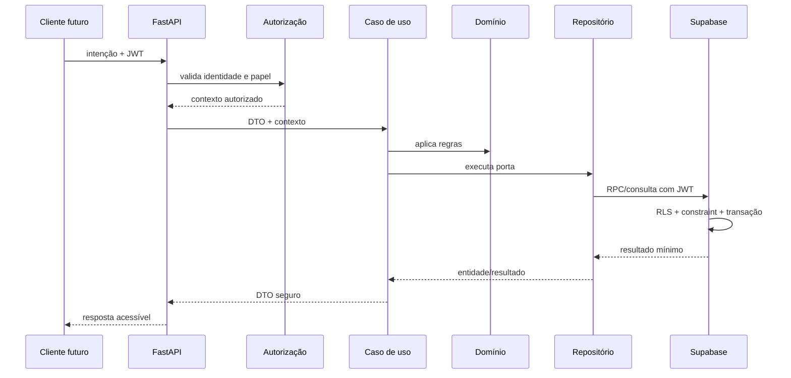

# Blueprint do back-end — Livre Acesso

## 1. Objetivo

Este documento define como o back-end recebe uma intenção, valida autorização, aplica regras, persiste dados, publica eventos e devolve uma resposta segura. O front-end será implementado por último e dependerá destes contratos, não o contrário.

## 2. Topologia proposta

```text
Vercel
├── Front-end React/TypeScript (última fase)
└── FastAPI em função Python, durante o MVP

Supabase
├── Auth e emissão de JWT
├── PostgreSQL
├── Row Level Security
├── funções RPC transacionais
├── schema privado de auditoria/outbox
└── Storage futuro
```

A Vercel possui suporte oficial a FastAPI e ASGI em Python: [FastAPI on Vercel](https://vercel.com/docs/frameworks/backend/fastapi). O código não usará APIs proprietárias da plataforma, preservando migração para Cloud Run ou Railway.

Supabase recomenda combinar Auth com RLS para proteger os dados até o nível de linha: [Row Level Security](https://supabase.com/docs/guides/database/postgres/row-level-security). A arquitetura do Auth e sua relação com objetos próprios está descrita na [documentação oficial](https://supabase.com/docs/guides/auth/architecture).

Content was rephrased for compliance with licensing restrictions.

## 3. Restrições do runtime

O backend na Vercel é stateless. Consequências:

- nenhuma informação permanente fica em variável global;
- o repositório em memória existe apenas para testes e desenvolvimento;
- arquivos locais não armazenam uploads ou estado;
- trabalho crítico não depende de `BackgroundTasks`;
- eventos externos são persistidos em outbox;
- toda operação precisa tolerar nova instância na requisição seguinte;
- chamadas repetidas precisam ser idempotentes quando houver efeito externo.

## 4. Fluxo de uma requisição



Cada camada responde a uma pergunta:

| Camada | Pergunta |
| --- | --- |
| Presentation | Como a intenção entra e como o resultado sai? |
| Auth context | Quem é a pessoa e o que ela pode fazer? |
| DTO | O formato é compreensível e válido? |
| Use case | Qual processo deve acontecer? |
| Domain | Qual regra não pode ser quebrada? |
| Repository port | De qual persistência o caso de uso precisa? |
| Supabase adapter | Como a operação chega ao PostgreSQL? |
| RLS/constraint | Qual é a última barreira de segurança e integridade? |
| Event/outbox | Quem reage depois que o fato foi persistido? |

## 5. Limites do domínio

### Aluno não é matrícula

`Student` representa a pessoa cadastrada. Não contém modalidade, turma ou lista de espera. Uma pessoa pode possuir várias matrículas ao longo do tempo e até participar de mais de uma modalidade.

### Matrícula representa o vínculo

`Enrollment` ligará aluno e turma e possuirá seu próprio estado. Pausa, cancelamento, conclusão e lista de espera não alteram automaticamente o estado global do aluno.

### Modalidade não é turma

Balé é modalidade; “Balé infantil — terça 9h” é turma. Capacidade, instrutor, horário e faixa pertencem à turma.

### Responsável possui relação reutilizável

Um responsável pode cuidar de mais de um aluno, e um aluno pode ter contatos diferentes. `student_guardians` registra relação, prioridade e autorização para comunicação. A primeira operação cria um responsável novo; reutilização automática só será adicionada quando existir um identificador confiável, pois telefone ou nome não bastam para unir pessoas com segurança.

### Alerta não toma decisão

O sistema pode detectar faltas ou possível inatividade, mas não cancela matrícula nem libera vaga sem uma regra aprovada e uma ação autorizada.

## 6. Dados e sensibilidade

| Dado | Classificação interna | Regra |
| --- | --- | --- |
| Nome | Pessoal | Exibir somente a perfis com finalidade operacional. |
| CPF | Pessoal de alto risco | Normalizar, restringir, mascarar e nunca registrar em log. |
| Nascimento | Pessoal | Usar para idade/faixa; evitar exposição desnecessária. |
| Telefone/e-mail | Pessoal de contato | Mascarar em listas e restringir acesso integral. |
| Presença | Pessoal comportamental | Acesso somente por finalidade educacional/operacional. |
| Credencial/JWT | Segredo de autenticação | Nunca persistir em log, banco de domínio ou resposta. |
| Papel do usuário | Autorização | Alteração exclusiva de fluxo administrativo auditado. |
| Auditoria | Segurança | Registrar ator, ação e campos, não copiar valores pessoais. |

## 7. Autenticação e autorização

1. Supabase Auth guarda senha e emite JWT.
2. FastAPI valida assinatura, algoritmo, expiração, emissor, audiência, anonimato e projeto usando o JWKS público.
3. Um `AuthenticatedUser` transporta somente `user_id`, `session_id`, nível de autenticação e o token protegido contra representação textual.
4. O token permanece apenas na requisição e autentica a chamada RPC.
5. A RPC consulta `profiles` e verifica o papel operacional; metadados editáveis do usuário não concedem acesso.
6. Supabase aplica constraints e RLS como barreira adicional.
7. `service_role` não participa de requisições normais e nunca chega ao navegador.

Contas novas começam pendentes e inativas. A primeira coordenação é promovida manualmente; depois haverá um caso de uso administrativo próprio.

## 8. Persistência Supabase

### Operações simples

Leituras seguras podem usar RPCs que devolvem somente colunas necessárias e dados mascarados.

### Operações compostas

Cadastro com responsável precisa ser uma transação única:

```text
validar autorização
→ inserir aluno
→ inserir responsável
→ criar vínculo principal
→ registrar auditoria
→ gravar evento na outbox
→ confirmar tudo
```

Se qualquer etapa falhar, nada é persistido.

### Concorrência

A consulta prévia de CPF melhora a mensagem, mas não evita corrida. A constraint única no PostgreSQL é a garantia definitiva. O adaptador traduz `duplicate_cpf` para conflito HTTP sem expor SQL.

### Paginação

Listagens sempre terão limite máximo. O backend nunca carrega todos os registros para filtrar em memória quando estiver conectado ao Supabase.

## 9. Eventos

### Síncronos

Eventos internos podem acionar listeners baratos dentro da requisição, desde que uma falha seja tratada conscientemente.

### Duráveis

Efeitos externos usam `private.outbox_events`. O payload deve conter IDs, não CPF, telefone, e-mail ou conteúdo completo de mensagens.

Eventos iniciais:

- `StudentRegistered`;
- `EnrollmentCreated`;
- `AttendanceRecorded`;
- `ConsecutiveAbsencesDetected`;
- `VacancyReleased`;
- `CommunicationRequested`.

## 10. Contratos intuitivos e acessíveis

Acessibilidade também começa no backend:

- mensagens em português simples, sem SQL ou stack trace;
- código de erro estável separado da mensagem;
- erros por campo para foco e leitura por tecnologia assistiva;
- datas em ISO 8601 e rótulos humanos fornecidos separadamente;
- nenhum significado comunicado apenas por cor ou número mágico;
- paginação com total e limites explícitos;
- estados nomeados, não booleanos ambíguos;
- operações destrutivas exigem intenção clara e autorização;
- OpenAPI descreve finalidade, campos sensíveis e próximos passos;
- IDs técnicos não substituem nomes visíveis na interface.

Formato-alvo de problema:

```json
{
  "type": "https://livreacesso.org/problems/duplicate-cpf",
  "title": "CPF já cadastrado",
  "status": 409,
  "detail": "Confira o cadastro existente antes de continuar.",
  "code": "duplicate_cpf",
  "request_id": "uuid",
  "errors": [
    {
      "field": "cpf",
      "message": "Este CPF já pertence a um cadastro."
    }
  ]
}
```

## 11. Política de comentários

Comentários explicam decisão, risco ou efeito; não traduzem sintaxe.

Comentar junto ao código quando houver:

- dado pessoal ou segredo;
- autorização;
- transação ou concorrência;
- efeito externo;
- idempotência;
- regra de negócio não óbvia;
- otimização baseada em medida;
- compatibilidade com plataforma.

Funções públicas recebem docstrings com responsabilidade, entrada, saída e efeitos relevantes. Comentários nunca contêm dados reais, tokens ou exemplos sensíveis.

## 12. O que não será adotado agora

- microserviços;
- Kafka/RabbitMQ;
- Redis sem medição;
- Celery;
- Kubernetes;
- dois bancos para o mesmo domínio;
- estado local em produção;
- ORM apenas por conveniência;
- triggers com decisão de negócio invisível;
- automação de cancelamento ou vaga sem confirmação.

## 13. Sequência de implementação

1. estabilizar testes e runtime local;
2. corrigir os limites entre aluno e matrícula;
3. criar migration de identidade, alunos e responsáveis;
4. validar JWT assimétrico por JWKS e proteger rotas;
5. implementar e testar o adaptador Supabase;
6. padronizar respostas de erro e paginação;
7. aplicar a migration e testar RPC/RLS por papel;
8. criar módulo de turmas;
9. criar módulo de matrículas;
10. criar chamada e alertas;
11. implementar outbox processor;
12. iniciar o front somente com contratos estáveis.

## 14. Critério de pronto do backend

Uma etapa só está pronta quando:

- regra foi descrita e validada;
- autorização foi definida;
- dado sensível tem tratamento explícito;
- sucesso, limite e falha possuem testes;
- transação e concorrência foram avaliadas;
- logs não expõem PII;
- OpenAPI e documentação foram atualizados;
- lint, formatação, tipos e testes passam;
- existe evidência de execução no ambiente apropriado.
